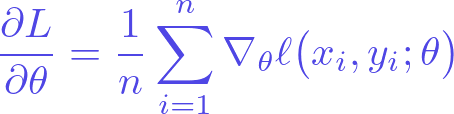

# dsh-latex

[](https://github.com/Accelerater-tech/dsh-latex/releases) [](LICENSE) [](https://github.com/Accelerater-tech/dsh-latex/actions/workflows/ci.yml)

让 harness 直接调用本机 LaTeX，并让 DeepSeek 的回复以公式块展示数学。

装好之后有两件事发生：

1. **聊天里的公式直接渲染成排版好的公式块。** 助手回复中的 `$...$`（行内）和
   `$$...$$`（独立成块）由聊天界面内置的 KaTeX 渲染，并带有
   `\(...\)` / `\[...\]` 两种等价写法。这部分不需要插件做任何事，插件负责的是
   下面的第 2 点，以及用一段 system prompt 让模型知道"该这样写"。
2. **多出一个 `latex` 工具**，真正调用本机 TeX Live 编译：公式 → SVG/PNG/PDF，
   整篇文档 → PDF。它是"要真产物"的路径（嵌进论文、贴进 Keynote、生成 PDF），
   而第 1 点是"看着舒服"的路径。



上面这张图就是 `latex` 工具的产物
（`\frac{\partial L}{\partial \theta}=\frac{1}{n}\sum_{i=1}^{n}\nabla_\theta\ell(x_i,y_i;\theta)`），
矢量版见 [`assets/example-formula.svg`](assets/example-formula.svg)。

## 依赖

- TeX Live / MacTeX。macOS 上 `/Library/TeX/texbin` 里的
  `latex`、`dvisvgm`、`dvipng`、`dvipdfmx`、`pdfcrop`、`xelatex`。
- 不需要 client 构建，也不需要 npm 依赖。

插件自己会在 `PATH`、`/usr/local/texlive/<年>/bin/<arch>`、`/Library/TeX/texbin`
里找这些程序，并在子进程里重排 `PATH`——桌面端 Electron 主进程经常拿不到
`/Library/TeX/texbin`，这一步不能省。

## 安装

DSH 里安装 bundle 统一走插件管理（不是 shell 里的 pnpm，也不要手改 profile 的
`package.json`）：

```
plugin_manager action=install_bundle target=<这个目录的绝对路径>
```

从 GitHub 装：

```bash
git clone https://github.com/Accelerater-tech/dsh-latex.git
```

然后在 DSH 里对着克隆出来的目录跑同一条 `install_bundle`。它会把包装进 profile
的 `node_modules` 并写入 bundle patch，返回里 `application: "applied"` 就说明已经
生效——纯 host 插件，不用构建，也不用重启。

装完可以直接验证：新的一轮系统提示里会出现 `## LaTeX` 段落，工具表里会多出
`latex`。

> 包里沿用本地私有名 `@local/dsh-latex`（不会发布到 npm）。要换成自己的名字，
> 同时改 `package.json` 和 `cordis.patch.yml` 里的 `name` 即可。
> 卸载：`plugin_manager action=remove_bundle target=@local/dsh-latex`。

## 用法

### 1. 聊天里写公式

```
行内：$e^{i\pi}+1=0$
独立：$$\int_{-\infty}^{\infty} e^{-x^2}\,dx = \sqrt{\pi}$$
多行：$$\begin{aligned} (a+b)^2 &= a^2+2ab+b^2 \\ &= b^2+2ab+a^2 \end{aligned}$$
```

KaTeX 渲染失败时会退回红色错误文本，不会把整条消息搞坏。

### 2. 调工具编译

```jsonc
// 公式 → 矢量 SVG（默认）
{ "source": "\\frac{\\partial L}{\\partial \\theta} = \\nabla_\\theta L" }

// 公式 → 300dpi PNG，文件名自己定
{ "source": "\\sum_{k=1}^{n} k = \\frac{n(n+1)}{2}", "format": "png", "output": "figures/sum.png" }

// 深色背景用的浅色墨
{ "source": "E = mc^2", "color": "#e5e7eb" }

// 整篇文档 → PDF（正文片段，自动套 preamble）
{ "mode": "document", "source": "\\section{结论}\n由上式可得 $x>0$ 时 $\\sqrt{x^2}=x$。" }

// 整篇文档 → PDF（已经是完整 .tex，原样编译）
{ "mode": "document", "source": "\\documentclass{ctexart}\n..." }
```

返回：

```json
{
  "ok": true,
  "mode": "math",
  "format": "svg",
  "engine": "latex",
  "files": [{ "path": "/abs/path/.dsh-latex/xxx.svg", "relative": ".dsh-latex/xxx.svg", "format": "svg", "bytes": 5603 }],
  "cwd": "/abs/path",
  "markdown": "",
  "texSource": "完整可复现的 .tex",
  "durationMs": 417
}
```

`markdown` 是可直接粘进回复的相对路径引用：图片在聊天里会内联显示
（`api/file?path=...`），文档则是一个打开侧栏的文件链接。相对路径按
**当前会话的工作目录**解析。

### 参数

| 参数 | 适用范围 | 说明 |
| --- | --- | --- |
| `source` | 必填 | `mode:"math"` 时是公式体（外层 `$$`/`\[\]` 会被剥掉）；`mode:"document"` 时是完整 `.tex` 或正文片段 |
| `mode` | | `math`（默认）/ `document` |
| `format` | math | `svg`（默认，矢量）/ `png` / `pdf` |
| `engine` | document | `pdflatex` / `xelatex` / `lualatex`；缺省时按是否含中文自动选 |
| `preamble` | | 插入 `\begin{document}` 之前的额外宏包行，例如 `\usepackage{bm}` |
| `displayMode` | math | 默认 `true`；`false` 时按行内公式排版 |
| `color` | math | 墨色，`#rrggbb` 或颜色名，默认黑色 |
| `dpi` | math png | 96–1200，默认 300 |
| `output` | | 输出路径（绝对或相对会话目录） |
| `documentClass` / `classOptions` | document | 包裹正文片段时用的文档类与选项 |
| `maxPasses` | document | 最多 5 遍，只在日志要求重跑时继续 |
| `force` | math | 忽略缓存重新编译 |

## 配置

在 bundle patch 的行里可以传：

```yaml
- insert:
    - id: dsh-latex
      name: '@local/dsh-latex'
      config:
        defaultFormat: svg      # svg | png | pdf
        defaultEngine: xelatex  # pdflatex | xelatex | lualatex
        dpi: 300
        timeoutMs: 120000       # 单次编译超时
        promptSection: true     # 是否注入 LaTeX 写法提示
        tool: true              # 是否注册 latex 工具
```

## 实现要点

- **产物裁白**：公式用普通 `article` 排版（`\pagestyle{empty}`），再由
  `dvisvgm --bbox=min --exact-bbox`、`dvipng -T tight`、`pdfcrop` 裁到内容尺寸。
  没有用 `standalone` 类——它在 DVI 模式下把正文塞进 `\hbox`，display math 会报
  `Missing $ inserted`，`align` 也排不了。
- **字形转路径**：`dvisvgm --no-fonts` 把字形转成 `<path>`，SVG 不依赖字体，任何
  查看器里都一致（代价是文件稍大）。
- **缓存**：源码 + 格式 + dpi + 墨色 的 sha256 作为作业目录名，重复调用直接复用。
- **失败信息**：从 `.log` 里只抽 `!`、`l.12`、`file:line:` 开头的诊断块，最多 24 行，
  避免把几千行日志塞回上下文。
- **注册方式**：工具与 prompt 段落的 disposer **没有**交给 `ctx.effect`——loader 在
  `apply()` 返回后会立刻提交 entry fiber 并执行 disposer，那样会把刚注册的工具静默注销
  （这个坑在 `dsh-search-boost` 的注释里有记录）。
- 没有 client 端：助手 markdown 的 KaTeX 渲染是聊天界面自带的，插件只用相对路径把
  编译产物写成图片/文件引用。

## 已知限制

- 公式图片默认黑色墨迹；深色主题下要么用 `color` 指定浅色，要么直接用聊天里的
  KaTeX 渲染（自动跟随主题）。
- `pdfcrop` 走的是 `pdftex`，首次调用会略慢。
- 需要 `\usepackage{...}` 的公式请写进 `preamble`，不要塞在 `source` 里。

## 开发

```bash
node test/smoke.mjs        # 不经过 harness，直接验证 TeX 管线
pnpm pack                  # 生成可分发 tarball
```

> CI：每次 push 到 `main` 都会在 GitHub Actions（Ubuntu + TeX Live）上跑同一条冒烟测试，见 [`.github/workflows/ci.yml`](.github/workflows/ci.yml)。

目录结构：

```
index.js            # 插件入口：注册 latex 工具 + system prompt 段落
lib/tex.js          # 引擎发现、编译管线、日志裁剪、缓存
cordis.patch.yml    # bundle patch：往 profile 里插一行
locale/{en,zh}.json # 插件管理里的标题/描述
icon.svg            # 插件图标
test/smoke.mjs      # 冒烟测试（直接用 lib/tex.js，不依赖 harness）
```

## 许可

[MIT](LICENSE)
